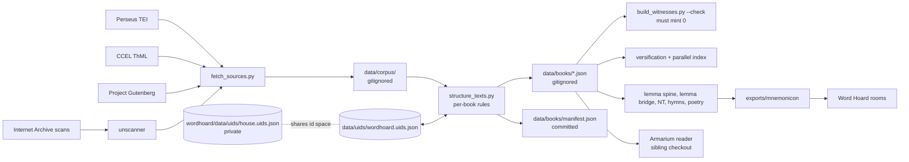

# HANDOFF: canon-corpus

Written 2026-11-02 so a developer or AI agent can pick this repo up cold, with no
access to Claude or past chat history. The detailed references are `CLAUDE.md`
(golden rules, every command, layout, rights), `README.md`,
`docs/DECISIONS-FOR-ADAM.md` (the open rulings, ordered by what they unblock),
the `pipeline/README-*.md` files, and `unscanner/README.md`. Where this file and
those disagree, they win.

State at time of writing: `main` at `cdf9a26` (2026-11-02), 194 commits.
`tests/structure_test.py` 147 passed, `tests/wh_uid_test.py` 67 passed.

**This repository is PUBLIC.** Nothing private (vault paths, Adam's own maxims,
household data) may be committed here.

---

## 1. Purpose

canon-corpus is the shared source-and-structure layer of the "Canon OS", the
library behind the Word Hoard. It fetches public-domain texts and converts
them into JSON keyed by stable unit ids, with canonical citations, scripture
cross-links and honest metadata about how precise each citation really is.
Sources include Perseus TEI, CCEL ThML, Project Gutenberg and Internet Archive
scans. It also holds the Bible versification maps, Latin and Greek lemma data,
dictionaries, poetry selections and hymns.

**Consumers:** the Armarium library and reader, and other Word Hoard rooms
(Mnemonicon decks, Memoria, the Nomenclator in Patrimonium, Vocabularium). The
Word Hoard repo calls this an "annex": outside the house on purpose.

**Owner:** Adam Kinunen, as a hobbyist. Beginner-friendly explanations are welcome.

## 2. Architecture

**Stack:** Python 3 scripts (mostly standard library; `tesseract` optional for
the Unscanner), JSON and JSONL data, SQLite FTS5 for the lemma bridge, one
Node/Playwright browser test. No server.

### Folder map

```
pipeline/
  fetch_sources.py        Manifest-driven fetchers (PERSEUS / CCEL / GUTENBERG_EXTRA dicts); resumable
  structure_texts.py      Converters: sources → data/books/*.json with unit ids; per-book fix rules live here
  wh_uid.py               Identity layer: mints and keeps uids
  build_*.py              Versification maps (Hebrew, Vulgate, Brenton, English Bibles → KJV), parallel index,
                          deuterocanon, KJV, NT pilot, hymns, poetry, progymnasmata, lemma spine/bridge, stories
  review.py               Applies Adam's answers from docs/review/*.md sheets into override rows
  export_mnemonicon_pack.py, render_reader.py, remint_maxims.py, extract_brewer.py, …
  README-*.md             Schemas and rules per dataset
unscanner/              Re-sets a scanned book as clean text + restored page images (python -m unscanner)
data/
  books/manifest.json     The committed record of the collection (checksums, schemes, provenance)
  uids/wordhoard.uids.json  The uid registry. COMMITTED. Losing it renames every identifier in the Word Hoard
  versification/, parallel/, lemmas/, lemma_bridge/, lexicons/, dictionaries/, nt/, hymns/, hymn-sources/,
  poetry/, stories/, echoes/, signatures/, art/, greppable/, unscanned/
exports/mnemonicon/     Generated import packs for the Mnemonicon (flashcards)
tests/                  34 test files; most run offline with no corpus
docs/                   DECISIONS-FOR-ADAM.md, MERGE-REHEARSAL.md, ART-PLAN.md, review/ sheets, context/
commonplace_contract.json   The Florilegium's frozen record contract
_to_delete/             54 MB of retired files, committed by mistake (see §6)
data/corpus/, build/    (gitignored) fetched sources and built JSON. Rebuildable
```

### Data flow



The rule behind it: **commit the manifest and the recipe; the texts refetch.**

## 3. Run locally (Windows, PowerShell)

### Prerequisites

| Tool | Notes |
|---|---|
| Python 3.10+ | `winget install --id Python.Python.3.12 -e` |
| Git | |
| Tesseract | optional, Unscanner only (`winget install --id UB-Mannheim.TesseractOCR -e`) |
| Node 20 + Playwright | optional, one browser test |
| Sibling repos | `armarium` (reader), `wordhoard` (private uid registry, maxims), `vocabularium`, `mnemonicon` for some exports |

### From a fresh clone

```powershell
Set-Location C:\Users\adamk\Claude\Projects
git clone https://github.com/Veritas-Essential-Services/canon-corpus.git
Set-Location canon-corpus

python tests\structure_test.py        # 147 offline checks
python tests\wh_uid_test.py           # 67 identity checks

python pipeline\fetch_sources.py --list   # what the manifests hold
python pipeline\fetch_sources.py          # fetch what is missing (long; resumable)
python pipeline\structure_texts.py        # build data\books\*.json and the manifest
python pipeline\build_witnesses.py --check   # THE GATE: a rebuild must mint 0 new uids
```

Every other build and test command, with what it checks, is listed in
`CLAUDE.md` under "Commands". Most builders have `--fetch` (pinned download),
`--check` (byte-identical rebuild) and `--audit` / `--measure` modes.

## 4. Deploy

Nothing is hosted. Output reaches users through consumers. Armarium reads
the built books from a sibling checkout; the Mnemonicon imports
`exports/mnemonicon/` packs; the Word Hoard house reads versioned files.

**Env var names** (paths to sibling checkouts and optional explore modes; no
secrets): `WORDHOARD_HOUSE`, `WORDHOARD_LATIN_DIR`, `VOCABULARIUM_DIR`,
`MNEMONICON_DIR`, `MNEMONICON_PLAYWRIGHT`, `CANON_HOARD_JS`, `BOOKS_OUT`,
`BRENTON_EXPLORE`, `ENGLISH_EXPLORE`.

## 5. External services

| Service | Used for |
|---|---|
| GitHub (`Veritas-Essential-Services/canon-corpus`, public) | Source; commit history is the acquisitions ledger |
| Perseus Digital Library (TEI on GitHub) | Greek and Latin texts, catalogues |
| CCEL | Christian classics (some prepared texts ask for non-commercial use) |
| Project Gutenberg / GITenberg mirror | English books, poetry |
| Internet Archive | Scans for the Unscanner, illustrations |
| STEPBible (TVTMS), OSHB, WLC, Robinson-Pierpont, Whitaker's WORDS, eBible.org | Versification, Hebrew and Greek texts, Latin morphology. Each is pinned; rights in `CLAUDE.md` |
| AmblesideOnline | Poetry and hymn rotations (titles and links) |
| Wikimedia Commons | Covers and art |

## 6. Current state

**Works (on `main`):** fetch and structure pipeline; the uid identity layer;
KJV and its italic witness; Hebrew, Vulgate, Brenton and five English Bible →
KJV versification maps; the parallel-Bible index; the deuterocanon key; Latin
hymns *Adoro te* and *Pange lingua*; John 1:1–18 Greek pilot; the
reverse-interlinear reader; the Latin lemma spine and English lemma bridge;
Brewer's *Phrase and Fable* and *Character Sketches*; Smith's dictionaries;
poetry catalogues (AmblesideOnline plus a treasury, Cowper's Guyon
translations); Aphthonius's progymnasmata; Treasure Island's story layer; the
Unscanner; Mnemonicon export packs; an acquisition wave for the illustrated
classics.

**Waiting:** nine open draft PRs (2026-11-02), most waiting on rulings in
`docs/DECISIONS-FOR-ADAM.md`:

- #6 upkeep and label fixes
- #7 Thayer, Perseus Greek and Latin, the fathers, Cramer
- #8 the whole Bible on KJV uids, plus the Apostolic Fathers, Josephus and Philo
- #10 Strong's numbers as word keys
- #11 English Apostolic Fathers, Charles, the Tudor Bibles, Wycliffe, Schaff
- #16 cross-reference and commentary layers
- #38 Lane B (held for shelf-by-shelf review)
- #44 relay lanes A–D shelves
- #52 Year 0 picture-book shelf

**Known issues:**
- `_to_delete/` (54 MB of zips, logs, a stale KJV backup and an old
  `git-lock` folder) is committed. The decision sheet item 20 recommends
  removing it.
- Item 12: the Perseus rights block is not copied into the committed manifest.
- The KJV Strong's tags have a licence conflict (public domain per eBible.org,
  GPL per CrossWire): build locally only until settled.

**TODOs in code:** none open (the `XXX` hits are Roman numerals in texts).

## 7. Next steps (prioritized)

1. **Get Adam's answers to `docs/DECISIONS-FOR-ADAM.md`.** "Yes to all" takes
   every recommendation. The ★ items block merges.
2. **Merge in the planned order.** #5, #9 and #12 are already merged. Next is #6,
   then #8, then rerun `python pipeline/build_parallel_index.py`, then #10, #7,
   #11, the relay (#44), and the rest. Repeat the trial merge first, because #7 has moved.
   `docs/MERGE-REHEARSAL.md` has the rehearsal.
3. **One attended uid-minting pass** after the merges (items 22–23): move
   per-book heading rules into `structure_texts.py` first, because they decide
   unit ids.
4. **Remove `_to_delete/`** in its own commit (`git rm -r _to_delete`); history keeps a copy.
5. **Fix item 12** (Perseus rights block into the manifest) before #7 merges.
6. Then the art plan (`docs/ART-PLAN.md`) and Year 0 shelf (#52, which
   wordhoard #250 waits on).

## 8. Gotchas

- **The repo is public.** Private citations live in
  `wordhoard/data/uids/house.uids.json`, which shares this id space and lists
  its uids here, bare, under `reserved`. Never delete a `reserved` entry.
  Never save the registry with a `wh_uid.py` older than 2026-09-27; an old one
  drops `reserved` on save.
- **A rebuild must mint zero.** `build_witnesses.py --check` is the gate. New
  uids mean something renamed identity.
- **Never hand-edit a source text.** Fixes go in per-book rules in
  `structure_texts.py` so they survive a refetch.
- **A partial build used to delete the ledger.** Builds are resumable and
  atomic (temp file + rename); keep them that way.
- **Never use SWORD / e-Sword module rips** as sources (and check that
  scrollmapper JSON is not converted from SWORD).
- **CC BY-SA markup over public-domain text** is not served whole for now.
- **Honesty fields matter:** every book's `scheme.honesty` states its real
  citation resolution. Never claim more precision than the source has.
- **One passage, many witnesses:** two editions of a verse are two witnesses
  (`<uid>/<witness>`), never two passages.
- **Never paste book text into chats, commits or docs;** stats and structure only.
- **Merges:** the usual conflict is `CLAUDE.md` test lists. Keep both sides,
  then remeasure the counts on the merged tree.

## 9. Decision log

| When | Decision |
|---|---|
| 2026-07-22 | Extracted from `patrimonium` (its history to `d33503e` is the earlier ledger) |
| 2026-07-26 | A rights check gates every acquisition (CLAUDE.md, "Rights check") |
| early | Manifests are the collection; corpus and built JSON are gitignored and refetch |
| early | The unit id is the citation spine; scheme changes need a vault ruling |
| 2026-09-06 | STEPBible Greek is the one non-public-domain source; how its limit is enforced is in CLAUDE.md |
| 2026-09-18 | Identity (`uid`) is separate from the citation; normative rules in the vault note `HOUSE STYLE — Addressing and Identity (2026-09-18)` |
| 2026-09-27 | Private ids move to the house's private registry; public registry keeps them bare under `reserved` |
| 2026-10-19 | Dictionaries of names (classical and literary) added as a door |
| Word Hoard ADRs | 0001 public domain only; 0002 source hierarchy Perseus → CCEL → Gutenberg, never SWORD; 0012 lemma bridge; 0015 opaque uids; 0019 CC BY with attribution; 0025 one citation grammar |
| Open | All of `docs/DECISIONS-FOR-ADAM.md` (items 1–24+) |

## SECURITY: rotate these

None found. The current tree and the last 100 commits were scanned for API
keys, tokens, private keys and passwords; the repo uses no credentials. The
main risk is privacy, because the repo is public: private Word Hoard
citations or household data must never land here.
